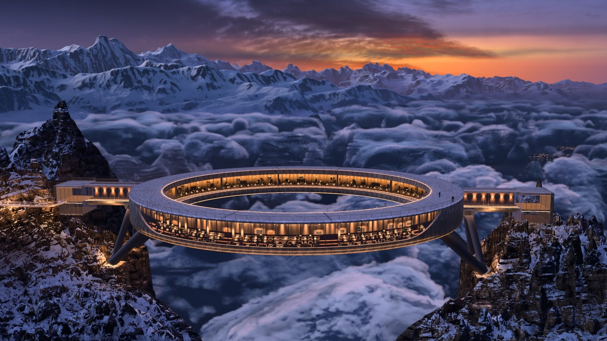
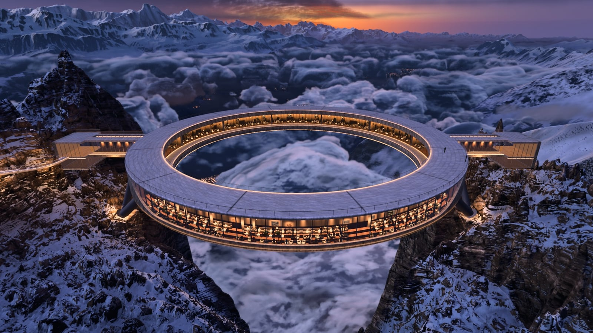
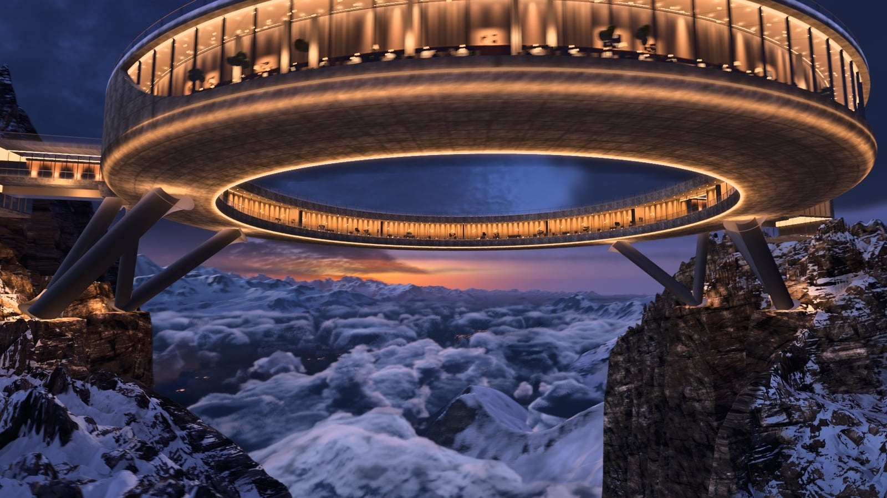

# Halo Above the Clouds

A concrete ring restaurant hanging between two snowy dolomite pinnacles at blue hour, above a sea of clouds, with
Lake Brienz and the Bernese Alps below. It is a real-time Three.js scene (r187, WebGL2), and a 45 s drone film rendered
offline from that same scene.



**[Watch the film (45 s, 1080p30, MP4)](https://github.com/Leonxlnx/halo-above-the-clouds/releases/download/v1.0/halo_film_1080p30.mp4)**

The scene was built by Claude Code (Claude Opus 5.5) from 11 AI-generated reference images, with several agents
working in parallel on terrain, rock and snow, clouds, sky, structure and the film. Every frame of the film is
rendered from the 3D scene. No reference image is projected into it.

| | |
|---|---|
|  |  |

## Run it

```bash
npm install
npm run data     # downloads the baked scene data (~0.3 GB) into data/
npm run dev
```

Open http://localhost:5173. The first load can take a few minutes while the shaders compile.

- **Drag** to orbit and **scroll** to zoom.
- **1–9, 0, −** jump to the camera views.
- **V** plays the film's camera path in real time.
- Add `?noclouds` to the URL on a weaker GPU.

## What is in the scene

- **Terrain** (`tools/terrain.mjs`, `src/terrain.js`, `src/glsl/rock.js`)
  - Real elevation data around the Brienzer Rothorn (46.787 N, 8.047 E).
  - Nested levels go from a 320 km horizon down to a hand-sculpted 1.6 km near field with the two pinnacles.
  - Polar far and mid levels for the Alps (`tools/fardem.mjs`, `tools/farmid.mjs`, `tools/farsummit.mjs`).
  - Baked sky visibility and horizon AO.
  - Snow and rock shading on top of Poly Haven textures.
- **Ring** (`src/structure.js`, `src/glsl/structure.js`)
  - 110 m across, with a roof deck, a glazed restaurant ring with an inner terrace, and V-struts.
  - Two bridges with glass pavilions and a cliff path.
  - Analytic LED and window light on the concrete.
- **Clouds** (`src/clouds.js`): a volumetric raymarch of a curved cloud sea at half resolution. Shape, billow, curl and
  detail noise volumes come from `tools/noise3d.mjs`, `tools/noise_billow.mjs` and `tools/noise_curl.mjs`. Light
  from the towns glows up from underneath.
- **Sky** (`tools/skybake.mjs`, `src/sky.js`, `src/glsl/common.js`, `src/glsl/far.js`)
  - A photo sky dome baked from CC0 HDRIs.
  - Twilight aerial perspective.
  - Shading for the distant ranges.
- **Valley** (`tools/lights.mjs`, `src/lights.js`, `src/glsl/water.js`): about 250k village and road lights, with
  reflections on the lake.
- **Post** (`src/post.js`): HDR bloom, a filmic grade with toe and shoulder, and grain.
- **Film** (`src/timeline.js`): 11 free-flight shots with roll, cuts, a fade-in and a fade-out.

`src/matte.js` can project the reference images onto far regions for stills. The reference images are not in this
repo, so the matte stays off. The film does not use it.

## Render the film

The renderer drives headless Chrome through `puppeteer-core`. It defaults to the standard Windows Chrome path; set
`CHROME` to use a different one.

```bash
npm run dev                                            # keep running in a second terminal
node tools/render.mjs --out out/frames --w 1920 --h 1080 --K 8 --jpg
powershell -File tools/encode.ps1 -Frames out/frames -Ext jpg -Audio music.wav
```

- **Sub-frames:** `--K` sets how many jittered sub-frames make up each frame. More sub-frames give more antialiasing and
  motion blur.
- **Speed:** at K 8 the film took about 5 s per frame on a laptop Radeon 780M, so roughly 2 h for all 1350 frames.
- **Resuming:** `render.mjs` skips frames that already exist, so you can stop it and pick up later. Use `--times 2,15.5`
  to render only the frames at those film times.
- **GPU lock:** renders take a machine-wide lock (`tools/gpulock.mjs`), so only one headless renderer uses the GPU at
  a time.

## Rebuild the data

`npm run data` is all you need to run the scene. To rebuild the data from scratch:

```bash
node tools/terrain.mjs --refetch   # fetch the DEM, sculpt, bake AO
node tools/lights.mjs              # village and road lights
node tools/noise3d.mjs             # cloud noise volumes (and noise_billow.mjs, noise_curl.mjs)
```

The sky dome (`tools/skybake.mjs`) is baked from two Poly Haven HDRIs. Download both at 8k before baking:

- *Belfast Sunset (Pure Sky)* to `data/sky/src/belfast_sunset_puresky_8k.hdr`
- *Cedar Bridge Sunset 1* to `data/sky/src_cedar/cedar_bridge_sunset_1_8k.hdr`

## Credits

- **Code:** MIT, see [LICENSE](LICENSE).
- **Elevation:** [AWS Terrain Tiles](https://registry.opendata.aws/terrain-tiles/) (Mapzen / Tilezen). It includes
  EU-DEM, produced using Copernicus data and information funded by the European Union, as well as SRTM, GMTED2010 and
  ETOPO1. See the
  [full attribution](https://github.com/tilezen/joerd/blob/master/docs/attribution.md).
- **Textures and sky HDRIs:** [Poly Haven](https://polyhaven.com), CC0.
- **Music in the film:** "Uprising" by Scott Buckley, released under CC BY 4.0, www.scottbuckley.com.au.
- **Libraries:** [three.js](https://threejs.org).
